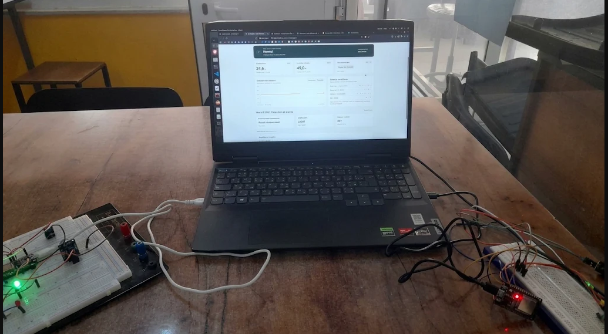
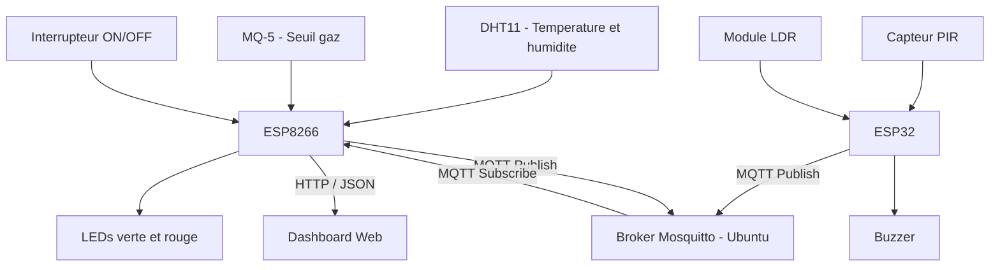
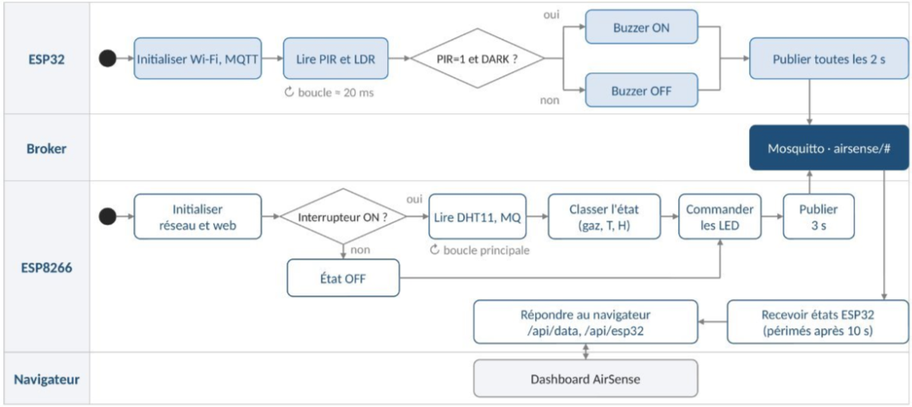
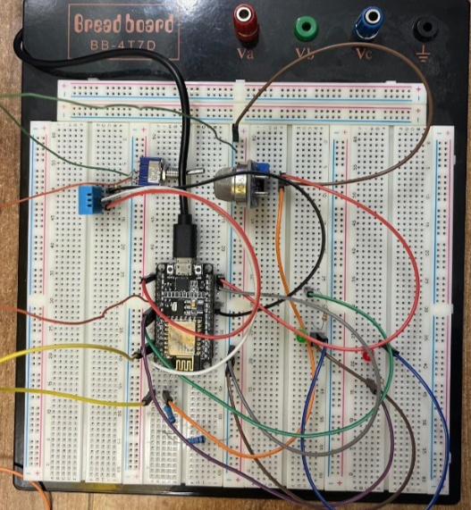
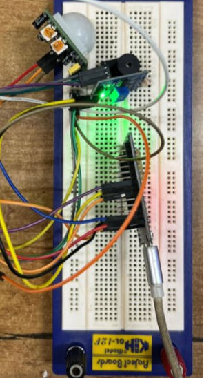
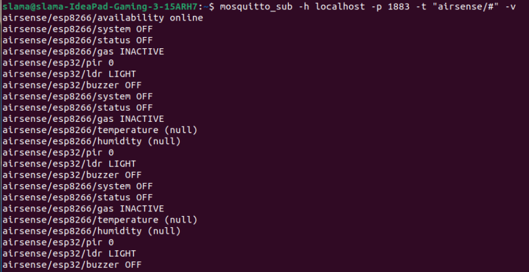
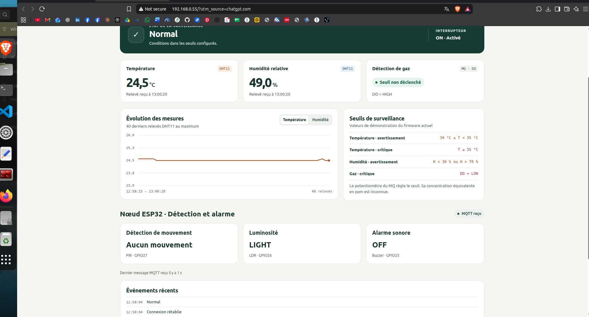
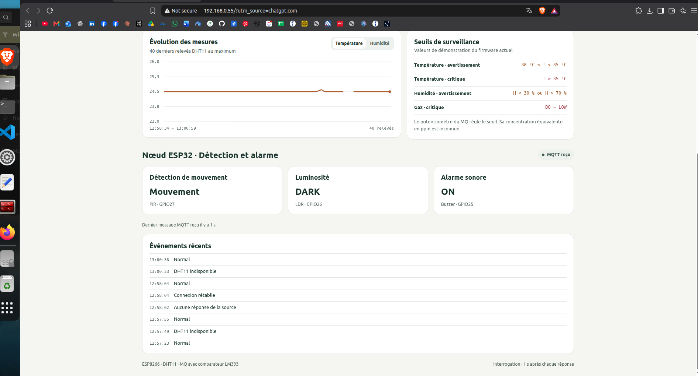

# AirSense — IoT Laboratory Monitoring & Security System


## 1. Présentation du projet

AirSense est un système IoT dédié à la surveillance environnementale et à la sécurité d'un laboratoire.

Ce projet a été réalisé en binôme dans le cadre d'un Travail Personnel Encadré (TPE) en capteurs intelligents à l'École Nationale d'Ingénieurs de Monastir (ENIM), en Génie Électrique, spécialité Informatique Industrielle et Instrumentation.

L'objectif est de surveiller les conditions ambiantes du laboratoire, de signaler les situations anormales et de détecter une intrusion potentielle, notamment en dehors des heures de travail.

Le système repose sur une architecture distribuée composée de deux microcontrôleurs, ESP8266 et ESP32, communiquant via Wi-Fi et MQTT.

<p align="center">
  
</p>

> Statut : prototype expérimental testé en réseau local. AirSense ne constitue pas un dispositif certifié de détection de gaz, d'incendie ou de sécurité.

## 2. Objectifs

- Surveiller la température et l'humidité du laboratoire.
- Détecter le dépassement d'un seuil de gaz.
- Signaler les situations environnementales anormales.
- Détecter un mouvement dans un environnement sombre.
- Déclencher automatiquement une alarme sonore.
- Assurer la communication entre deux nœuds IoT.
- Centraliser les données dans un dashboard web local.

## 3. Architecture du système

AirSense est composé de deux nœuds IoT complémentaires.

### Nœud 1 — ESP8266 : surveillance environnementale

- Acquisition de la température et de l'humidité avec le DHT11.
- Détection du dépassement d'un seuil de gaz avec le MQ-5.
- Gestion des seuils de surveillance.
- Signalisation des états par LEDs.
- Activation et désactivation par interrupteur.
- Publication des données via MQTT.
- Réception des états du nœud ESP32.
- Hébergement du serveur web et de l'API JSON.

### Nœud 2 — ESP32 : détection et alarme

- Détection de mouvement par un capteur PIR.
- Détection de luminosité par un module LDR.
- Activation du buzzer en cas de mouvement dans l'obscurité.
- Publication périodique des états via MQTT.

### Architecture de communication

Les deux microcontrôleurs communiquent via un réseau Wi-Fi local avec un broker MQTT Mosquitto hébergé sur un PC Ubuntu.

L'ESP8266 héberge le dashboard web permettant de centraliser les données des deux nœuds.



## 4. Organigramme de fonctionnement

<p align="center">
  
</p>

La logique de sécurité du nœud ESP32 repose sur la combinaison des informations issues des capteurs PIR et LDR.

| Mouvement PIR | Luminosité LDR | Buzzer |
|---|---|---|
| Non | LIGHT | OFF |
| Non | DARK | OFF |
| Oui | LIGHT | OFF |
| Oui | DARK | ON |

L'obscurité est utilisée comme indicateur d'une situation potentiellement anormale. Le système ne vérifie pas directement les horaires de travail ni l'identité des personnes.

## 5. Matériel utilisé

| Composant | Fonction |
|---|---|
| ESP8266 NodeMCU | Surveillance environnementale et serveur web |
| ESP32 | Détection et commande de l'alarme |
| DHT11 | Température et humidité |
| MQ-5 avec comparateur LM393 | Détection d'un seuil de gaz |
| PIR | Détection de mouvement |
| Module LDR | Détection de luminosité |
| Module buzzer (+, -, S) | Alarme sonore |
| LED verte | Signalisation de l'état normal |
| LED rouge | Signalisation des anomalies |
| Interrupteur | Activation et désactivation |
| Résistances | Protection et adaptation des signaux |
| Breadboards et câbles Dupont | Prototypage |

### Connexions ESP8266

| Composant | Broche NodeMCU | GPIO |
|---|---|---|
| DHT11 DATA | D2 | GPIO4 |
| MQ-5 DO | D1 | GPIO5 |
| LED verte | D5 | GPIO14 |
| LED rouge | D6 | GPIO12 |
| Interrupteur | D7 | GPIO13 |

### Connexions ESP32

| Composant | Signal | GPIO |
|---|---|---|
| PIR | OUT | GPIO27 |
| Module LDR | DO | GPIO26 |
| Buzzer | S | GPIO25 |

Vérifier les tensions d'alimentation, les masses communes de chaque montage, les résistances des LEDs et la compatibilité des signaux avec la logique 3,3 V avant tout branchement.

Les tableaux indiquent les affectations des signaux et ne constituent pas un schéma électrique complet validé.

## 6. Réalisation matérielle

### Montage ESP8266

<p align="center">
  
</p>

### Montage ESP32

<p align="center">
  
</p>

## 7. Technologies utilisées

| Domaine | Technologies |
|---|---|
| Systèmes embarqués | ESP8266, ESP32 |
| Programmation | C/C++, Arduino Framework |
| Développement | VS Code, PlatformIO |
| Communication réseau | Wi-Fi, TCP/IP, MQTT |
| Broker MQTT | Eclipse Mosquitto |
| Serveur web | HTTP, API JSON |
| Interface utilisateur | HTML, CSS, JavaScript |
| Système d'exploitation | Linux Ubuntu |
| Gestion de versions | Git, GitHub |

## 8. Communication MQTT

Le broker Mosquitto assure les échanges de données entre les deux nœuds.

L'ESP32 publie les informations relatives au mouvement, à la luminosité et à l'état du buzzer.

L'ESP8266 publie les mesures environnementales et s'abonne aux topics du nœud ESP32 afin d'afficher ses états dans le dashboard.

### Topics MQTT

| Topic | Valeurs ou exemples |
|---|---|
| `airsense/esp32/pir` | `0` / `1` |
| `airsense/esp32/ldr` | `LIGHT` / `DARK` |
| `airsense/esp32/buzzer` | `OFF` / `ON` |
| `airsense/esp8266/temperature` | `24.5` |
| `airsense/esp8266/humidity` | `49.0` |
| `airsense/esp8266/gas` | `NORMAL` / `ALERT` / `INACTIVE` |
| `airsense/esp8266/status` | `NORMAL` / `WARNING` / `CRITICAL` / `OFF` / `SENSOR_ERROR` |
| `airsense/esp8266/system` | `ON` / `OFF` |
| `airsense/esp8266/availability` | `online` / `offline` |

### Vérification de la communication

```bash
mosquitto_sub -h localhost -p 1883 -t 'airsense/#' -v
```

<p align="center">
  
</p>

Cette capture illustre la réception des messages MQTT des deux nœuds. Lorsque le système environnemental est désactivé, les mesures peuvent être indisponibles.

## 9. Dashboard web

Le dashboard est hébergé directement sur l'ESP8266 et accessible depuis un navigateur connecté au réseau local.

Il permet :

- L'affichage de la température et de l'humidité.
- La visualisation de l'état du capteur de gaz.
- L'affichage graphique des derniers relevés.
- La consultation des seuils de surveillance.
- La visualisation des états PIR, LDR et buzzer.
- Le suivi de la réception des messages MQTT.
- La consultation des événements récents.

### API HTTP

| Endpoint | Fonction |
|---|---|
| `GET /` | Dashboard web |
| `GET /api/data` | Mesures et état ESP8266 |
| `GET /api/esp32` | États ESP32 et fraîcheur des messages MQTT |

### Seuils de démonstration

| Paramètre | Condition | État |
|---|---|---|
| Température | 30 °C ≤ T < 35 °C | WARNING |
| Température | T ≥ 35 °C | CRITICAL |
| Humidité | H < 30 % ou H > 70 % | WARNING |
| Gaz | DO = LOW | CRITICAL |

Ces seuils sont utilisés pour la démonstration du prototype et ne constituent pas des seuils réglementaires de sécurité.

## 10. Résultats expérimentaux

### Scénario 1 — Fonctionnement normal

Les essais réalisés sur le prototype physique ont permis d'observer les résultats suivants :

| Paramètre | Résultat observé |
|---|---|
| Température | 24,5 °C |
| Humidité relative | 49 % |
| Gaz | Seuil non déclenché |
| PIR | Aucun mouvement |
| LDR | LIGHT |
| Buzzer | OFF |
| Communication MQTT | Messages reçus |
| État environnemental | NORMAL |

<p align="center">
  
</p>

### Scénario 2 — Détection et activation de l'alarme

Lorsqu'un mouvement est détecté dans l'obscurité, la logique de commande de l'ESP32 active le buzzer.

| Paramètre | Résultat observé |
|---|---|
| PIR | Mouvement détecté |
| LDR | DARK |
| Buzzer | ON |
| Communication MQTT | Messages reçus |

<p align="center">
  
</p>

### État de validation

- [x] Acquisition de la température et de l'humidité.
- [x] Affichage de l'état du capteur MQ.
- [x] Communication Wi-Fi.
- [x] Publication et réception MQTT.
- [x] Supervision des deux nœuds IoT.
- [x] Affichage graphique des mesures.
- [x] Observation du scénario PIR + DARK avec buzzer ON.
- [ ] Validation complète des scénarios d'alerte environnementale.
- [ ] Validation de la stabilité électrique sur une longue durée.
- [ ] Tests approfondis de reconnexion réseau.
- [ ] Calibration quantitative du capteur de gaz.

## 11. Installation et utilisation

### Prérequis

- VS Code.
- PlatformIO.
- Ubuntu ou environnement compatible.
- Broker MQTT Mosquitto.
- Réseau Wi-Fi local compatible 2,4 GHz.
- ESP8266 et ESP32.

### Cloner le dépôt

```bash
git clone https://github.com/Tasnimslama/AirSense-IoT.git
cd AirSense-IoT
```

L'accès au dépôt nécessite une autorisation tant qu'il reste privé.

### Installation de Mosquitto sous Ubuntu

```bash
sudo apt update
sudo apt install mosquitto mosquitto-clients
sudo systemctl start mosquitto
sudo systemctl status mosquitto
```

Vérifier que le broker écoute sur une interface accessible depuis le réseau local :

```bash
sudo ss -lntp | grep 1883
```

Selon la configuration de Mosquitto, une configuration d'écoute réseau supplémentaire peut être nécessaire.

Ne jamais exposer le port 1883 directement sur Internet.

### Configuration des deux cartes

Créer les fichiers de configuration locaux :

```bash
cp ESP8266/include/config.example.h ESP8266/include/config.h
cp ESP32/include/config.example.h ESP32/include/config.h
```

Identifier l'adresse IP locale du PC hébergeant Mosquitto :

```bash
hostname -I
ip route get 1.1.1.1
```

Renseigner les paramètres dans les deux fichiers `config.h` :

```cpp
#pragma once

#define WIFI_SSID "YOUR_WIFI_SSID"
#define WIFI_PASSWORD "YOUR_WIFI_PASSWORD"
#define BROKER_IP "YOUR_BROKER_IP"
```

Ne pas ajouter d'espace à la fin de l'adresse IP.

Les fichiers `config.h` sont exclus du versionnement par `.gitignore`.

### Compilation et téléversement ESP8266

```bash
cd ESP8266

pio run -e nodemcuv2
pio device list
pio run -e nodemcuv2 -t upload --upload-port /dev/ttyUSBX
```

### Compilation et téléversement ESP32

```bash
cd ../ESP32

pio run -e esp32dev
pio device list
pio run -e esp32dev -t upload --upload-port /dev/ttyUSBX
```

Remplacer `/dev/ttyUSBX` par le port correspondant à chaque carte.

### Moniteur série

```bash
pio device monitor --port /dev/ttyUSBX --baud 115200
```

### Accès au dashboard

1. Connecter le PC et les deux cartes au même réseau local.
2. Activer le broker Mosquitto.
3. Identifier l'adresse IP de l'ESP8266 dans son moniteur série.
4. Activer l'interrupteur du système.
5. Ouvrir dans un navigateur :

```text
http://IP_ESP8266/
```

## 12. Structure du dépôt

```text
AirSense-IoT/
├── ESP8266/
│   ├── include/
│   │   ├── config.example.h
│   │   └── airsense_dashboard.h
│   ├── src/
│   │   └── main.cpp
│   └── platformio.ini
├── ESP32/
│   ├── include/
│   │   └── config.example.h
│   ├── src/
│   │   └── main.cpp
│   └── platformio.ini
├── docs/
│   ├── architecture/
│   │   ├── architecture.png
│   │   └── flowchart.png
│   ├── screenshots/
│   │   ├── prototype.jpg
│   │   ├── dashboard-normal.png
│   │   ├── dashboard-alarm.png
│   │   └── mqtt-validation.png
│   └── wiring/
│       ├── esp8266-setup.jpg
│       └── esp32-setup.jpg
├── .gitignore
└── README.md
```

## 13. Limites et sécurité

- Le MQ-5 indique un franchissement de seuil numérique, et non une concentration de gaz calibrée en ppm.
- Les seuils environnementaux sont des valeurs de démonstration.
- La détection de luminosité dépend du réglage du module LDR.
- La logique PIR/LDR signale une intrusion potentielle sans identifier les personnes ni vérifier les horaires.
- Le prototype utilise MQTT sans TLS ni authentification.
- Le système doit être utilisé sur un réseau local de confiance.
- Les adresses IP et les ports USB peuvent changer après reconnexion.
- La stabilité de l'alimentation et de la communication nécessite des essais complémentaires.
- Aucun identifiant confidentiel ne doit être publié dans le dépôt ou son historique Git.

## 14. Perspectives d'amélioration

- Amélioration de la stabilité électrique.
- Optimisation de la reconnexion Wi-Fi et MQTT.
- Authentification MQTT et chiffrement TLS.
- Enregistrement permanent des mesures.
- Notifications à distance.
- Gestion des horaires de surveillance.
- Calibration quantitative des capteurs.
- Conception d'une carte PCB dédiée.

## 15. Références techniques

- [Documentation ESP8266 Arduino Core](https://arduino-esp8266.readthedocs.io/)
- [Documentation Arduino ESP32](https://docs.espressif.com/projects/arduino-esp32/en/latest/)
- [Documentation PlatformIO](https://docs.platformio.org/)
- [Eclipse Mosquitto](https://mosquitto.org/documentation/)
- [Protocole MQTT](https://mqtt.org/)
- [PubSubClient](https://github.com/knolleary/pubsubclient)
- [Adafruit DHT Sensor Library](https://github.com/adafruit/DHT-sensor-library)

## 16. Auteurs

Projet réalisé en collaboration par :

- **Tasnim Slama**
- **Fatma Mrabet**

**Établissement :** École Nationale d'Ingénieurs de Monastir (ENIM)

**Formation :** Génie Électrique — Informatique Industrielle et Instrumentation (3I)

**Année universitaire :** 2026–2027

## 17. Licence

Aucune licence open source n'est accordée pour le moment. Une licence pourra être ajoutée après vérification du dépôt et accord des collaboratrices.

---

**AirSense — From Smart Sensors to IoT Supervision**

ENIM | Electrical Engineering | 2026
